# Purchase Order Analytics: Power BI Report

An end-to-end Power BI report that turns raw SAP purchase-order extracts into a decision tool for a procurement manager: where spend goes, which suppliers and plants drive it, which purchase orders still need an invoice, and which vendors to recognise each quarter.

**Tools:** Power BI Desktop · Power Query (M) · DAX · Data modelling (star schema)

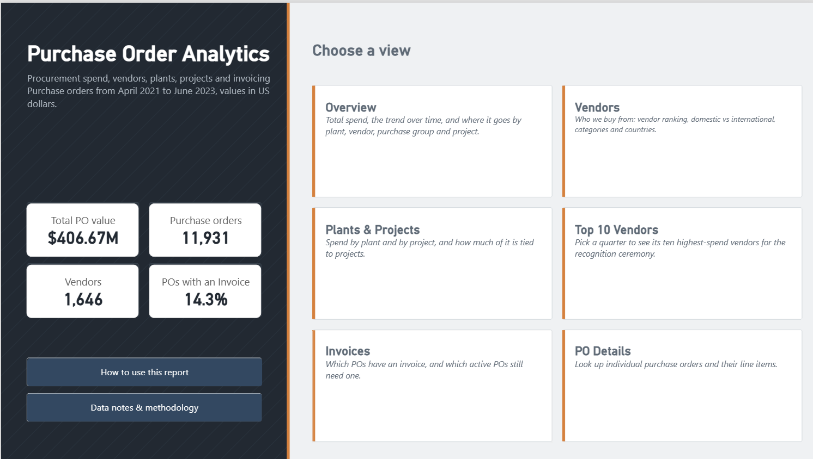

---

## Contents

- [Business problem](#business-problem)
- [Key insights](#key-insights)
- [Report walkthrough](#report-walkthrough)
- [Data preparation](#data-preparation)
- [Data model](#data-model)
- [DAX highlights](#dax-highlights)
- [Design and usability](#design-and-usability)
- [Testing and validation](#testing-and-validation)
- [Repository structure](#repository-structure)
- [Skills demonstrated](#skills-demonstrated)

---

## Business problem

**Context.** A manufacturing company with 11 plants in India runs its purchasing in SAP. Its purchase-order data was available only as four separate SAP extracts (PO headers, PO line items, vendor master and invoices), in seven currencies, with significant data-quality issues and no single view of spend.

**Objective.** Give the purchasing manager one report that answers five questions:

1. How much are we spending, and how is it trending?
2. Where does spend go: which plants, projects, vendors and purchase groups?
3. Which vendors were the top 10 in each quarter, for the supplier recognition ceremony?
4. Which purchase orders have no invoice yet, and how long have they been open?
5. How much value was cancelled?

**Constraints.** Values in US dollars (millions); filters for year, month, plant, vendor and purchase group; navigation simple enough for a first-time Power BI user; and a path from any KPI to the underlying purchase orders.

### Requirements and how they were met

| Requirement from the brief | How the report meets it |
|---|---|
| PO amount by plant, project and vendor | Dedicated visuals on Overview, Vendors and Plants & Projects; header amounts allocated to lines so every breakdown reconciles to the total |
| Filters for vendor, plant, purchase group, year and month | Synced slicer strip on every analysis page, with a one-click reset |
| A details page reachable from any KPI | Every KPI card opens PO Details with the current filters; every chart supports drill-through |
| Trend by year and month | Year → quarter → month drill-down on the Overview |
| Clear navigation for a Power BI beginner | Title page with navigation tiles, page navigator on every page, and a user-guide page |
| Top 10 vendors each quarter | Top 10 Vendors page with a quarter picker and dynamic ranking |
| Dates without time | All dates typed as dates and shown as dd-mmm-yyyy |
| Homepage styled like a presentation | Designed title page with headline KPIs |
| Whether an invoice exists for each PO | Invoice status on every PO, coverage charts and an aged follow-up list |
| Cancelled PO value | KPI card implementing the exact rule given (line count = count of deletion indicators) |
| Values in USD millions | All currencies converted with official annual exchange rates; amounts shown as $…M |

## Key insights

Based on 11,931 purchase orders created between April 2021 and June 2023 (plus one from 2018):

| Area | Finding |
|---|---|
| **Scale** | **$406.67M** of PO value across **11,931 POs** from **1,646 vendors**. |
| **Growth** | Like-for-like, January–June 2023 PO value is **up 152%** on January–June 2022. |
| **Plants** | Three plants account for **98.5%** of spend; Gurgaon alone accounts for **62%**. |
| **Supplier concentration** | The top 10 vendors receive **44.1%** of spend; the largest single vendor **11.8%**. In individual quarters, one vendor took up to two-thirds of the top-10 value. |
| **International sourcing** | **37.3%** of spend goes to international suppliers, led by Germany and China. |
| **Projects** | **90.2%** of spend is linked to a project. |
| **Invoicing** | Only **14.3%** of POs have an invoice. **9,894 active POs worth $238.25M** have none, and **6,194** of them have been open for more than 180 days. Invoice records begin in 2022, so part of the gap is data coverage rather than process. |
| **Cancellations** | **338 POs (4.6% of value, $18.84M)** were cancelled. |

## Report walkthrough

The report opens on a title page (shown above) with headline KPIs and navigation tiles. Every analysis page shares the same header, synced slicers (year, month, plant, vendor, purchase group) and KPI strip, and every KPI card opens the PO Details page with the current filters.

### Overview
Where does spend go, and how is it trending? A year → quarter → month trend, plus the top 5 plants, vendors, purchase groups and projects.

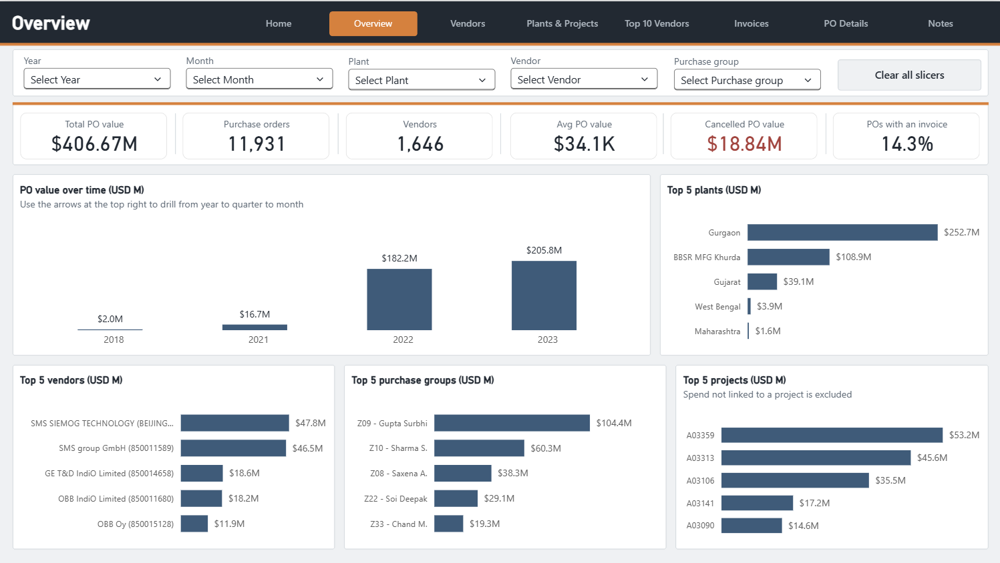

### Vendors
Who are the key suppliers, and how concentrated is spend? A full vendor ranking with data bars, domestic vs international spend, vendor types and the main international supplier countries.

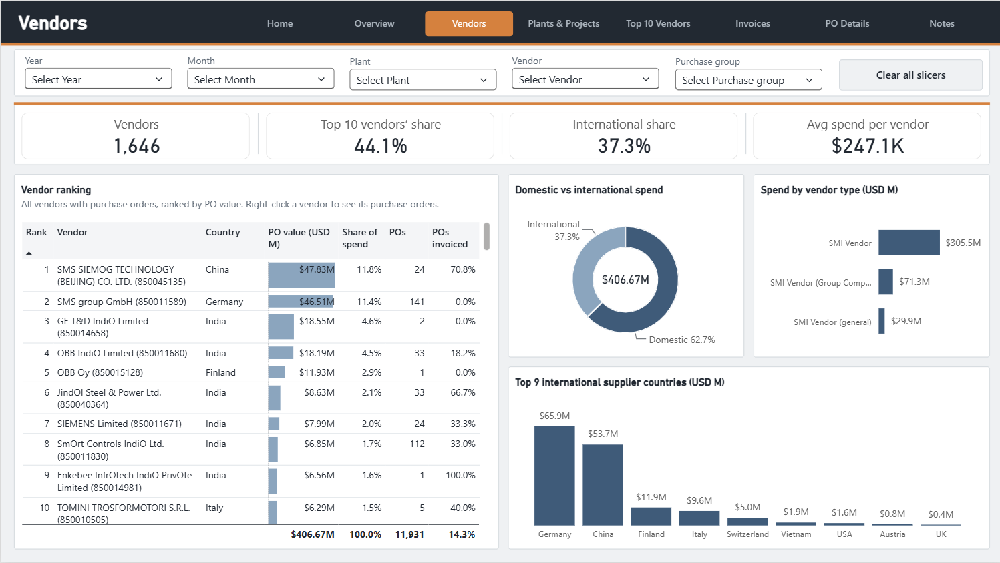

### Plants & Projects
Which plants and projects drive spend? All 11 plants, project vs non-project spend, PO types and the top 10 projects.

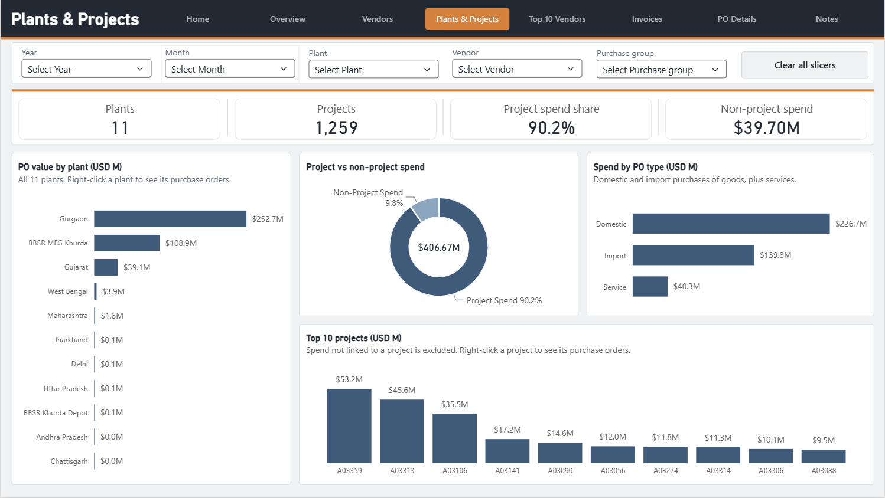

### Top 10 Vendors
Supplier recognition: pick a quarter to rank its ten highest-spend vendors, with each vendor's share of the quarter, last quarter's value and a dynamic title. A second chart tracks how concentrated spend is from quarter to quarter.

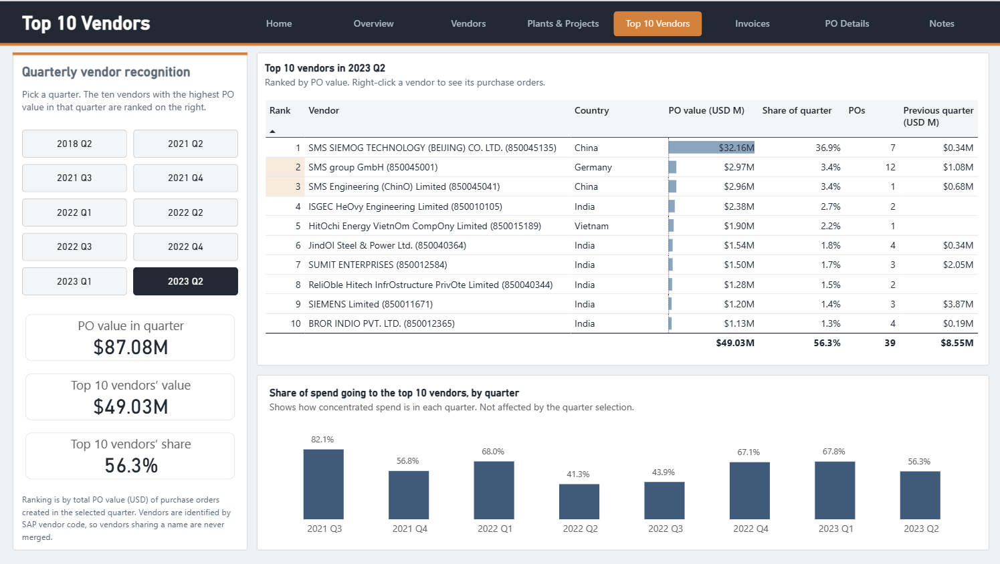

### Invoices
Which POs still need an invoice? Invoice coverage by PO quarter, invoiced amount by invoice date, and a follow-up list of active POs without an invoice, largest first, with POs open more than 180 days in red.

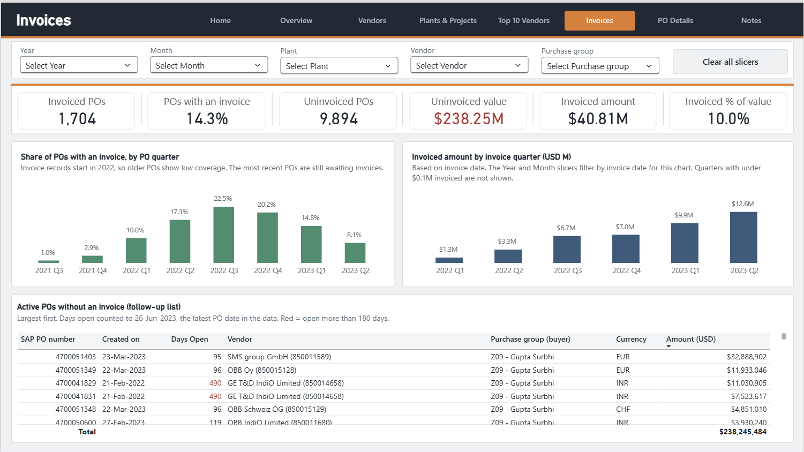

### PO Details
Drill-through page: right-click any bar, vendor or project (here, project A03359) to see the purchase orders and line items behind it.

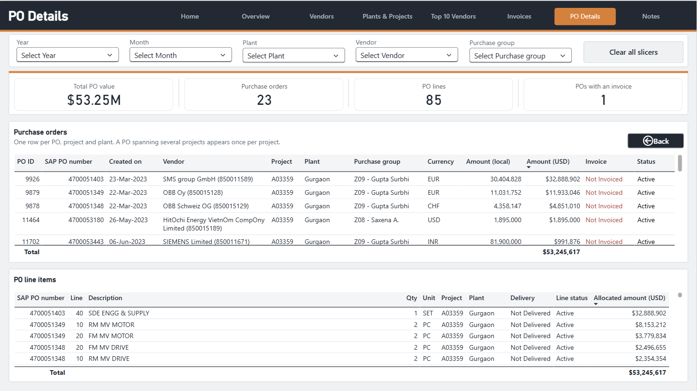

### Notes
Data sources, cleaning steps, key assumptions, the exchange rates used and the reconciliation check.

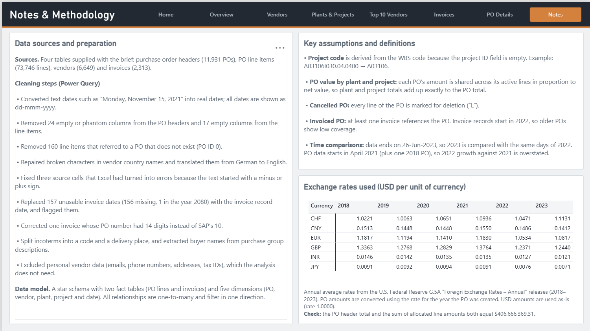

### How to use (hidden page)
A user guide opened from the Home page: how to navigate and filter, the business questions each page answers, and report information with a dynamic "data as of" date.

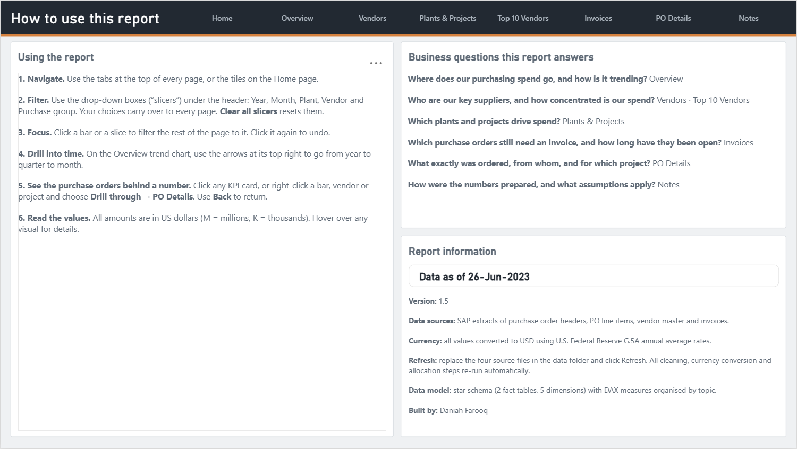

## Data preparation

**Sources:** four SAP extracts supplied with the brief: PO headers (11,931 rows), PO line items (73,746), vendor master (6,649) and invoices (2,313). Vendor names are masked in the source.

All cleaning is done in Power Query with named, commented steps. Raw queries are kept untouched in a separate group and read their files through a `DataFolder` parameter, so the whole pipeline re-runs on new files with a single refresh.

| Issue found during profiling | Treatment |
|---|---|
| PO dates stored as text ("Monday, November 15, 2021") | Converted to real dates; all dates shown as dd-mmm-yyyy |
| 24 empty or phantom columns in PO headers; 17 empty columns in line items | Removed |
| `ProjectId` 100% empty, although projects are a core requirement | **Project code derived from the WBS code** with a documented rule (e.g. `A03106I030.04.0400` → `A03106`) |
| PO amount exists only at header level, but plant and project are line attributes | **Header amount allocated to lines by net value**; deleted lines get no share unless the whole PO is cancelled. Totals reconcile exactly to the header |
| 160 line items referencing a non-existent PO (ID 0) | Removed as orphans |
| Vendor country names in German with broken encoding ("Dänemark") | Encoding repaired, names translated to English |
| 87 vendors in use share a name with another vendor | Unique display name (name + SAP code) so rankings never merge two vendors |
| Three source cells turned into Excel errors (text starting with "-" or "+") | Two replaced with the intended values; the third was in a column not used in the model |
| 157 unusable invoice dates (156 missing, one in the year 2080) | Replaced with the invoice record date and flagged |
| One invoice with a 14-digit PO number (SAP uses 10) | Corrected; every invoice now links to a PO |
| Seven currencies | Converted to USD with annual average rates from the U.S. Federal Reserve G.5A release, by currency and PO year |
| Personal vendor data (emails, phone numbers, addresses, tax IDs) | Excluded: not needed for the analysis |

Full Power Query code: [`power_query/`](power_query/)

## Data model

A star schema with two fact tables and five dimensions. All relationships are one-to-many and filter in a single direction. The invoice-date relationship is inactive and switched on only inside the measure that needs it.

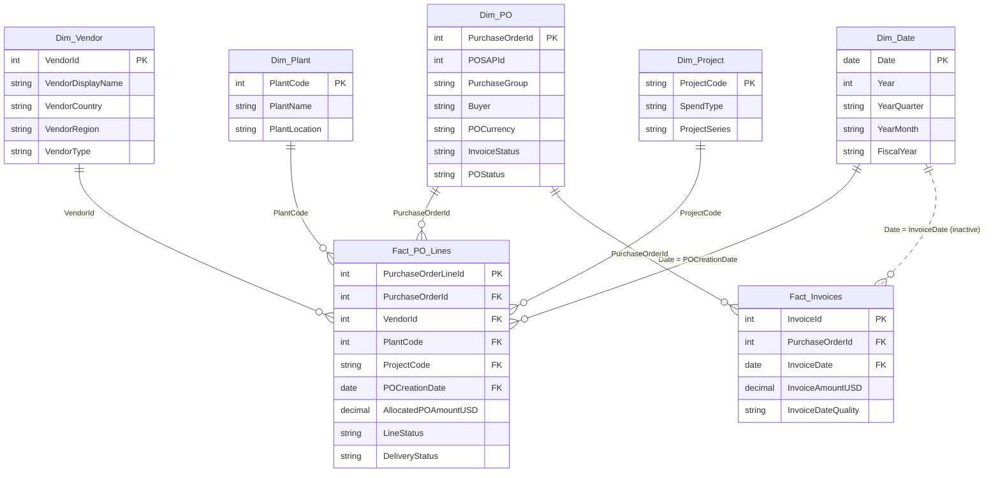

Model view in Power BI:

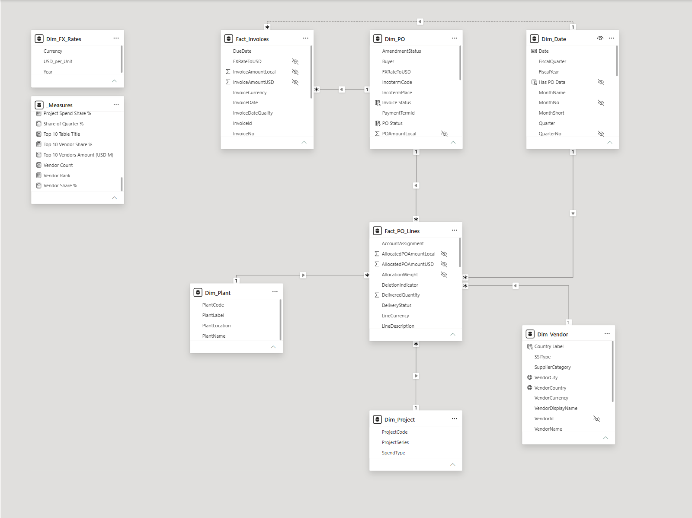

The model also contains a dedicated `_Measures` table and a standalone `Dim_FX_Rates` reference table (rates are applied in Power Query, so it needs no relationship).

## DAX highlights

44 measures in 8 display folders, all built on a single base measure. The full catalogue with explanations is in [`dax/DAX_Measures.md`](dax/DAX_Measures.md), and calculated columns in [`dax/Calculated_Columns.md`](dax/Calculated_Columns.md).

**Cancelled PO value: the business rule implemented exactly as specified** (a PO is cancelled when its line count equals its count of deletion indicators):

```dax
Cancelled PO Amount USD =
VAR CancelledPOs =
    FILTER (
        VALUES ( Fact_PO_Lines[PurchaseOrderId] ),
        CALCULATE ( COUNTROWS ( Fact_PO_Lines ) )
            = CALCULATE ( COUNTROWS ( Fact_PO_Lines ), Fact_PO_Lines[DeletionIndicator] = "L" )
    )
RETURN
    CALCULATE ( [PO Amount USD], CancelledPOs )
```

**Like-for-like previous year.** Data ends on 26 June 2023, so a naive comparison would set half of 2023 against all of 2022 (+13%). Shifting only dates that have data gives the fair comparison (+152%):

```dax
PO Amount PY USD =
CALCULATE (
    [PO Amount USD],
    CALCULATETABLE ( DATEADD ( Dim_Date[Date], -1, YEAR ), Dim_Date[Has PO Data] = TRUE () )
)
```

**Invoices by invoice date, while still respecting vendor, plant and project filters.** `USERELATIONSHIP` activates the inactive date relationship; `TREATAS` carries the PO selection across fact tables:

```dax
Invoice Amount by Invoice Date (USD M) =
VAR POsInScope =
    CALCULATETABLE ( VALUES ( Fact_PO_Lines[PurchaseOrderId] ), REMOVEFILTERS ( Dim_Date ) )
RETURN
    DIVIDE (
        CALCULATE (
            SUM ( Fact_Invoices[InvoiceAmountUSD] ),
            USERELATIONSHIP ( Dim_Date[Date], Fact_Invoices[InvoiceDate] ),
            TREATAS ( POsInScope, Fact_Invoices[PurchaseOrderId] )
        ),
        1000000
    )
```

**Share of the whole quarter inside a Top 10 table.** `ALLSELECTED` would divide by the top 10 only; `REMOVEFILTERS` divides by all vendors:

```dax
Share of Quarter % =
DIVIDE ( [PO Amount USD], CALCULATE ( [PO Amount USD], REMOVEFILTERS ( Dim_Vendor ) ) )
```

## Design and usability

- **Designed before built:** page wireframes with exact positions, a custom theme ([`design/`](design/)) and PowerPoint-style background images for consistent layout.
- **Consistent page structure:** header with page navigator, synced slicer strip (year, month, plant, vendor, purchase group), KPI strip, then trend, breakdowns and detail.
- **Navigation from any KPI:** every KPI card links to the PO Details page with the current filters; every chart supports right-click drill-through.
- **Purposeful colour:** one accent colour; red only for values that need attention (cancelled value, uninvoiced value, POs open more than 180 days).
- **Built for a non-technical user:** plain-language titles, Top 5 summaries on the overview with full rankings on detail pages, and a hidden user-guide page.

## Testing and validation

- **Reconciliation query** in Power Query proves the line-level allocation equals the PO header total: $406,666,369.31 on both sides, across all 11,931 POs ([`power_query/09_Check_Reconciliation.m`](power_query/09_Check_Reconciliation.m)).
- **Core measures were tested in DAX query view** against values calculated independently from the raw data, and every page was checked against expected figures before it was signed off.
- **Profiling evidence:** column quality and distribution checks on the full dataset, before and after cleaning.

## Repository structure

```
├── README.md
├── dax/
│   ├── DAX_Measures.md          # all 44 measures, grouped and explained
│   └── Calculated_Columns.md
├── power_query/                 # M code for every query
│   ├── 00_Raw_Sources_and_Parameter.m
│   ├── 01_Dim_FX_Rates.m
│   ├── 02_Dim_PO.m
│   ├── 03_Dim_Vendor.m
│   ├── 04_Fact_Invoices.m
│   ├── 05_Fact_PO_Lines.m
│   ├── 06_Dim_Plant.m
│   ├── 07_Dim_Project.m
│   ├── 08_Dim_Date.m
│   └── 09_Check_Reconciliation.m
├── data/
│   └── FX_Rates_Annual.csv      # exchange-rate table (U.S. Federal Reserve G.5A)
├── design/
│   └── Steelworks_Procurement_theme.json
└── screenshots/
```

The source data is not included in this repository. The .pbix report file is available on request.

## Skills demonstrated

- **Data profiling and cleaning:** systematic profiling, documented fixes for encoding errors, text dates, orphan records, invalid values and missing fields.
- **Data modelling:** star schema design, handling two fact tables at different grains, allocation of header values to line level, inactive relationships.
- **DAX:** filter-context control (CALCULATE, TREATAS, USERELATIONSHIP, REMOVEFILTERS, ALLSELECTED), dynamic ranking, like-for-like time intelligence, fiscal-year calculations.
- **Report design:** wireframing, custom theme, consistent layout, drill-through, synced slicers, accessible navigation.
- **Analytical thinking:** turning a brief into business questions, flagging data-coverage caveats, validating results before publishing.

---

**Author:** Daniah Farooq · [LinkedIn](https://www.linkedin.com/in/daniah-farooq-629220197) · [GitHub](https://github.com/daniahfarooq)
